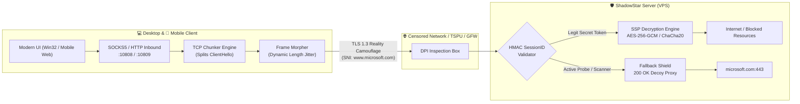

# ⭐ ShadowStar (SSP) • Next-Gen Anti-DPI Stealth Proxy

[](https://github.com/komendant-zero/shadowstar/releases)
[](https://golang.org)
[]()
[](https://opensource.org/licenses/MIT)
[]()

> **[🇬🇧 English](#-english-overview) | [🇷🇺 Русский](#-обзор-на-русском)**

---

## 🇬🇧 English Overview

**ShadowStar (SSP)** is an advanced, high-performance stealth proxy protocol engineered from the ground up to bypass modern Deep Packet Inspection (**DPI, TSPU, GFW, SNI-filtering**) and resist active network probing.

It provides a complete cross-platform ecosystem:
- **Universal Cross-Platform TUI Client** — A zero-dependency, cyberpunk interactive terminal interface with real-time speed sparklines and live logs (<10MB RAM).
- **Mobile Ecosystem (Android & iOS PWA)** — Built-in mobile gateway with offline Service Worker support, touch UX, and native Android `VpnService` integration.
- **Bilingual Interface** — Instant runtime switching between English and Russian (`[RU | EN]`).



### ⚡ Key Capabilities
1. **TLS 1.3 Reality Masking**: Traffic is cryptographically indistinguishable from legitimate HTTPS traffic to verified enterprise domains (`www.microsoft.com`, `cloudflare.com`).
2. **TCP Chunker**: Splits TLS `ClientHello` across TCP packet boundaries with randomized micro-delays, defeating SNI inspection without TLS handshake failure.
3. **Dynamic Frame Morphing**: Adds cryptographically pseudo-random padding (16–256 bytes) to every frame, defeating neural-network length-signature classifiers.
4. **Shield Fallback (Anti-Active Probing)**: When censors probe the port, the server transparently proxies the connection to a real decoy domain, returning authentic TLS certificates and HTTP 200 OK.
5. **Multi-Node Manager & Subscriptions**: Supports single `shadowstar://` URIs, Base64 subscription links, JSON configs, concurrent ping tests, and automatic fastest-node selection.

---

### 🖥️ Interactive TUI Client (Windows, Linux, macOS)
Written in pure Go with zero external dependencies (ANSI VT100 / Raw Console).
- **Run**: `shadowstar -c shadowstar-client.json` (or `./run-personal-pc.bat`)
- **Keybindings**:
  - `[C]` / `[Space]` — Connect / Disconnect tunnel
  - `[↑]` / `[↓]` (or `[k]` / `[j]`) — Navigate server nodes
  - `[Enter]` — Select & switch active node
  - `[F]` — Auto-select and connect to the fastest server (lowest ping)
  - `[P]` — Ping all servers concurrently
  - `[S]` — Toggle System Proxy (WinINet on Windows)
  - `[A]` — Add node modal (`shadowstar://` URI or `ip:port:key`)
  - `[D]` — Delete node modal
  - `[U]` — Update from subscription URL
  - `[Tab]` / `[R]` — Instant bilingual switch (`RU` | `EN`)
  - `[1]`, `[2]`, `[3]` — Switch views: Servers, Live Tunnel Logs, Protocol Diagnostics
  - `[Q]` / `[Esc]` — Clean exit with graceful proxy restoration

### 📱 Mobile Client (Android APK & PWA)
- **Direct Android APK**: Download the signed APK directly from [GitHub Releases](https://github.com/komendant-zero/shadowstar/releases) (`ShadowStar.apk`), install on your Android phone, and tap Connect!
- **Local APK Build**: Run `powershell -ExecutionPolicy Bypass -File scripts/build-apk.ps1` to automatically build and sign debug APKs using Android SDK 34 (`aapt2`, `javac`, `d8`, `zipalign`, `apksigner`).
- **Progressive Web App (PWA)**: Open `http://<IP>:10810` on any mobile browser (iOS/Android) and tap **Add to Home Screen**.
- **Android Native Sources**: Source code located in `mobile/android_src/` with hardware-accelerated WebView UI and background `ShadowStarVpnService`.

---

### 🚀 Server Quick Start (Linux VPS)
Run one-line automated installation on Ubuntu, Debian, CentOS, or AlmaLinux:
```bash
curl -fsSL https://raw.githubusercontent.com/komendant-zero/shadowstar/main/scripts/install.sh -o install.sh && sudo bash install.sh
```
The installer configures:
- Automated system architecture detection (`x86_64` / `aarch64`)
- Linux kernel BBR congestion control optimization
- Systemd service (`shadowstar.service`)
- UFW / Firewalld port configuration
- Generates `shadowstar://` link and console QR code

---

## 🇷🇺 Обзор на русском

**ShadowStar (SSP)** — это высокоскоростной протокол скрытного проксирования нового поколения, разработанный для гарантированного обхода систем глубокой фильтрации трафика (**ТСПУ РКН, GFW, DPI, блокировок по белым спискам и протоколам**) и защиты от активного сетевого сканирования.

### 🌟 Преимущества перед классическими протоколами
| Ограничение стандартных VPN/Shadowsocks | Решение в ShadowStar (SSP) |
| :--- | :--- |
| **Высокая энтропия первого пакета** (DPI блокирует случайные байты) | **TLS 1.3 Reality**: трафик на 100% идентичен настоящему сеансу браузера к доверенному домену (`www.microsoft.com`). |
| **Анализ длин пакетов** (нейросети выявляют размеры рукопожатий) | **Dynamic Frame Morphing**: в каждый кадр подмешивается случайный шум (16–256 байт), полностью скрывая сигнатуру. |
| **Фильтрация по SNI в первом TCP сегменте** | **TCP Chunker**: ClientHello дробится на несколько фрагментов с микрозадержкой. Оборудование ТСПУ пропускает поток без детекта. |
| **Активное зондирование цензоров** (сканирование подозрительных IP) | **Shield Fallback**: если подключение не содержит верного криптографического HMAC-токена, сервер проксирует скан на настоящий сайт Microsoft. Зонд получает ответ 200 OK! |
| **Тяжелые клиенты на Electron** (250+ МБ ОЗУ) | **Interactive TUI**: сверхбыстрое кроссплатформенное терминальное приложение с нулевыми зависимостями, потребляющее <10 МБ ОЗУ. |

---

### 🖥️ Кроссплатформенный интерактивный TUI-клиент (Windows, Linux, macOS)
Полноценный интерактивный консольный терминал без сторонних зависимостей (чистый Go, ANSI VT100 / Raw Console) с живыми графиками скоростей (sparklines) и логами в реальном времени.
- **Запуск**: запустите `shadowstar.exe` (или `run-personal-pc.bat`). На Linux/macOS запускается командой `./shadowstar`.
- **Горячие клавиши**:
  - `[C]` / `[Пробел]` — Подключение / Отключение туннеля
  - `[↑]` / `[↓]` (или `[k]` / `[j]`) — Навигация по списку серверов
  - `[Enter]` — Переключение и активация выбранного узла
  - `[F]` — Авто-выбор самого быстрого сервера с минимальным пингом
  - `[P]` — Одновременный пинг всех узлов
  - `[S]` — Переключение системного прокси (WinINet)
  - `[A]` — Модальное окно добавления узла (`shadowstar://` или `ip:port:key`)
  - `[D]` — Удаление выбранного узла
  - `[U]` — Обновление серверов по ссылке подписки
  - `[Tab]` / `[R]` — Мгновенное переключение языка (`RU` | `EN`)
  - `[1]`, `[2]`, `[3]` — Переключение вкладок (Узлы / Живые логи / Диагностика криптостека)
  - `[Q]` / `[Esc]` — Безопасный выход с корректной очисткой прокси и терминала

---

### 📱 Мобильная версия (Android APK и PWA)
- **Готовый установочный APK-файл**: Скачайте готовый подписанный `ShadowStar.apk` прямо из [GitHub Releases](https://github.com/komendant-zero/shadowstar/releases). Установите на телефон и подключитесь в один клик.
- **Автоматическая сборка APK**: Скрипт `powershell -ExecutionPolicy Bypass -File scripts/build-apk.ps1` собирает и подписывает APK с помощью инструментов Android SDK 34 (`aapt2`, `javac`, `d8`, `zipalign`, `apksigner`).
- **PWA (iOS и Android)**: Откройте в браузере телефона адрес мобильного шлюза (например: `http://192.168.1.50:10810`) и нажмите **«Добавить на главный экран»** (Add to Home Screen).
- **Исходный код Android**: Расположен в каталоге `mobile/android_src/` с нативным `VpnService`, аппаратным ускорением WebView и поддержкой всех версий Android от 8.0 до 15+.

---

## 📦 Сборка и релизы (Build & Releases)

### Автоматическая сборка GitHub Releases
В репозитории настроен GitHub Actions Workflow (`.github/workflows/release.yml`), который при пуше тега версии (`v*`) автоматически собирает релизные архивы под все платформы:
- `ShadowStar.apk` — Готовое Android-приложение (APK, v2/v3 signature)
- `shadowstar-windows-amd64.zip` — Windows Desktop GUI & Client
- `shadowstar-linux-amd64.tar.gz` — Linux x86_64 CLI Client & Server
- `shadowstar-linux-arm64.tar.gz` — Linux ARM64 CLI Client & Server
- `shadowstar-mobile-android-arm64.tar.gz` — Android ARM64 Gateway
- `shadowstar-mobile-windows-amd64.zip` — Windows Mobile Gateway

### Ручная компиляция:
```powershell
# Сборка десктопного клиента Windows:
go build -ldflags="-s -w" -o bin/shadowstar.exe ./cmd/shadowstar

# Сборка сервера под Linux x86_64:
GOOS=linux GOARCH=amd64 CGO_ENABLED=0 go build -ldflags="-s -w" -o bin/shadowstar-server-linux-amd64 ./cmd/shadowstar-server

# Сборка мобильного шлюза под Android ARM64:
GOOS=android GOARCH=arm64 CGO_ENABLED=0 go build -ldflags="-s -w" -o bin/shadowstar-mobile-android-arm64 ./cmd/shadowstar-mobile
```

---

## 🔒 Безопасность и приватность (Security & Privacy)
- **Zero-Logs Architecture**: Клиент и сервер не ведут журналов посещенных сайтов и передаваемых данных.
- **Изоляция личных данных**: Конфигурационные файлы личных серверов (`*.personal.json`, `run-personal-*.bat`) строго изолированы и добавлены в `.gitignore`.
- **Шифрование сессий**: AES-256-GCM / ChaCha20-Poly1305 с уникальным эфемерным ключом для каждого TCP-потока.

---

## 📄 Лицензия
Проект распространяется под свободной лицензией [MIT](LICENSE).
